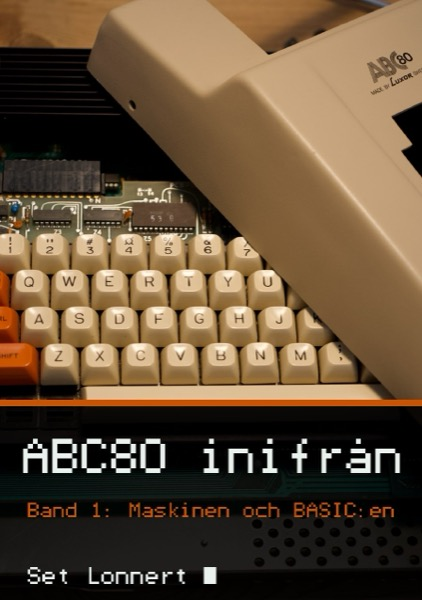
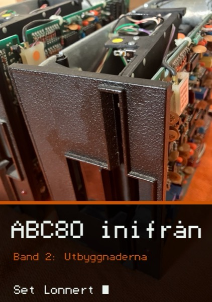

# ABC80 inifrån

Material till boken *ABC80 inifrån* (Set Lonnert): källor och program
som boken beskriver, så att de kan köras och ändras.

Boken kommer snart ut i två band hos BoD (Books on Demand), 190 × 270 mm:

- **Band 1: Maskinen och BASIC:en** (244 s., ISBN 978-91-8150-657-0).
  Datorn själv: kretskortet, Z80:an, minnet, bildskärmen,
  tangentbordet, ljudet, kassetten och ABC-bussen. Sedan hela
  BASIC-tolken i ROM:en, rutin för rutin, och de två ROM-versionerna
  11273 och 9913 jämförda.
- **Band 2: Utbyggnaderna** (266 s., ISBN 978-91-8134-515-5).
  Minneskortet, bussarna, diskoperativsystemen, skivminnet, skrivarna
  och IEC-bussen, med koden i UFD-DOS, skrivarkretsen 9704 och
  IEC-kretsen 4027. Smartaid, Superbasic, 80 tecken och färg, CP/M,
  texttelefonen och nät. Sist BASIC II för ABC80, jämförd med den
  första tolken.

Emulatorn går att köra direkt i webbläsaren, utan att något installeras:
[https://feyerabend.github.io/ABC80/inifran/emulator/webb/abc80.html](https://feyerabend.github.io/ABC80/inifran/emulator/webb/abc80.html)
Sidan går också att bygga själv: ROM:arna ligger inte i förrådet, och
`make webb` i [`emulator/`](emulator/) hämtar dem och bygger
`emulator/webb/abc80.html` (se
[`emulator/roms/LASMIG.md`](emulator/roms/LASMIG.md)).

- [`forth/`](forth/): en liten Forth för ABC80 (band 2, exempel 7)
- [`exempel/`](exempel/): program i en krets, exempel 1–6 (band 2)
- [`tidslinje.md`](tidslinje.md): tidslinjen från bokens bilaga
- [`disass/`](disass/): kommenterade disassembleringar av ABC80:s BASIC
  och BASIC II för ABC80, som mallar utan koden; `bygg.sh` hämtar ROM:en
  och bygger PDF:en
- [`verktyg/`](verktyg/): assemblern och emulatorn som bokens exempel
  byggs och provas med
- [`emulator/`](emulator/): emulatorn med kassett, diskett och ljud, i
  terminalen och som en enda fil i webbläsaren (`webb/abc80.html`), med
  exempelprogram på band och diskett
- [`utanfor/`](utanfor/): utanför boken, men i dess anda: experiment om
  hur ABC80 kunde ha utvecklats, till exempel en snabbare Forth, med vad
  som är ändrat och mot vad; häftet *Utanför boken* beskriver dem
  ([`utanfor/utanfor.pdf`](utanfor/utanfor.pdf))
